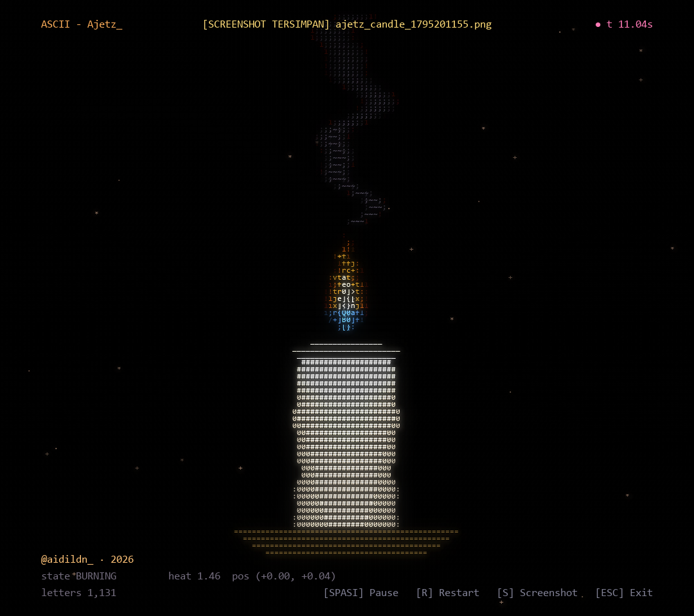

# 🌌 ASCII Art - Generative & Procedural Terminal Visualizers

[](https://www.python.org/)
[](https://pyga.me/)
[](https://numpy.org/)
[](#coming-soon--roadmap)

Repositori ini merupakan laboratorium kreatif untuk eksplorasi **seni komputasional prosedural dan visualizer berbasis karakter tipografi ASCII murni (*ASCII Shader Architecture*)**. 

Setiap piksel di layar tidak dibentuk oleh gambar tekstur pra-render, melainkan dihitung secara matematis secara *real-time* menjadi karakter-karakter monospaced dengan dinamika pencahayaan, simulasi fluida, serta pendaran (*bloom glow*) khas terminal retro.

> [!NOTE]
> **AI Assistance Disclaimer**
> Proyek-proyek dalam repositori ini, termasuk formulasi matematika prosedural, algoritma shader visual, dan dokumentasinya, dikembangkan dengan bantuan alat kecerdasan buatan (*AI tools*).

---

## 💡 Konsep Inti & Filosofi Desain

Proyek-proyek dalam repositori ini dibangun di atas pilar-pilar konseptual berikut:

1. **Tipografi sebagai Satuan Piksel (*Typography as Pixels*)**:
   Mengubah karakter teks ASCII standar (`.`, `:`, `*`, `#`, `@`, glif geometri) menjadi representasi densitas energi, tingkat suhu, orientasi tangen medan vektor, dan kedalaman 3D.
2. **Procedural Software Shader**:
   Seluruh kalkulasi dilakukan pada jaring koordinat bidang 2D ternormalisasi menggunakan vektorisasi NumPy, mengevaluasi medan skalar (*scalar heat & density fields*) frame demi frame tanpa aset eksternal.
3. **Simulasi Fisika & Medan Energi**:
   Menerapkan pendekatan fisik pada dinamika cahaya, konveksi panas, gerak turbulensi fluida, hingga perambatan gelombang kejut (*shockwave propagation*).
4. **Pendaran Terminal Retro (*Multi-Pass Phosphor Bloom*)**:
   Efek visual terminal CRT dicapai melalui teknik *downsampling* dan *additive Gaussian blur*, memberikan aura cahaya organik pada karakter ASCII yang menyala.

---

## 📂 Galeri Proyek

### 1. 🔥 [Candle Flame & Flying Fire](candle_flame/)
> **Status: Selesai & Aktif**

Simulasi prosedural atmosferik yang menceritakan perjalanan sebutir roh api melayang di dalam kegelapan pekat (*pitch black*), mendekati lilin mati, menyulut sumbu lilin (*ignition contact*), dan melepaskan gelombang kejut cahaya lingkaran (*circular shockwave*) yang seketika menyapu serta menerangi seluruh ruangan.

* **Fitur Utama**:
  * *Darkness Masking*: Sistem pencahayaan dinamis di mana seluruh ruang gelap total sebelum api dinyalakan.
  * *Radial Shockwave*: Gelombang cahaya berbentuk lingkaran ekspansif dengan kontur tangen ASCII dinamis (`/`, `-`, `\`, `|`).
  * *Sustained Burn*: Nyala api lilin konvektif dengan dasar biru hidrokarbon, inti emas leleh, dan asap organik yang meliuk.
  * *Interactive Controls*: Kontrol keyboard interaktif untuk jeda (*pause*), mulai ulang (*restart*), dan tangkapan layar instan (*screenshot capture*).
* **Direktori Proyek**: [`candle_flame/`](candle_flame/)
* **Dokumentasi Lengkap**: Baca panduan mendalam di [`candle_flame/README.md`](candle_flame/README.md).



---

## 🚀 Konsep Mendatang (*Coming Soon & Roadmap*)

Repositori ini akan terus berkembang dengan berbagai eksplorasi konsep seni ASCII lainnya:

* 🪐 **Gravitational Celestial Body / Orbital Singularity** *(Coming Soon)*:
  Simulasi distorsi ruang-waktu relativistik, cakram akresi (*accretion disk*) berputar dengan pergeseran Doppler, dan pelensaan gravitasi (*gravitational lensing*) berbasis partikel ASCII.
* 🌊 **Fluid Dynamics & Ripple Propagation** *(Coming Soon)*:
  Simulasi mekanika fluida 2D interaktif (Navier-Stokes ter-diskritisasi) yang menampilkan riak gelombang air dan interaksi partikel terapung.
* ⚡ **Cyberpunk Neon Matrix & Digital Rain** *(Coming Soon)*:
  Visualizer aliran data kaskade vertikal dengan efek dispersi spektrum warna neon dan modulasi glitch audio-reaktif.
* 🌀 **Harmonic Lissajous & Morphing Fractals** *(Coming Soon)*:
  Eksplorasi matematika murni melalui kurva parametrik kinetik, himpunan fraktal Mandelbrot/Julia, serta pola interferensi gelombang berulang.

---

## 🛠️ Struktur Direktori

```text
ASCII/
├── README.md                  # Dokumentasi utama repositori ASCII Art
├── .gitignore                 # Konfigurasi filter berkas Git
└── candle_flame/              # Proyek: Candle Flame & Flying Fire
    ├── candle.py              # Engine visualizer prosedural
    ├── requirements.txt       # Dependensi pustaka Python
    ├── README.md              # Dokumentasi teknis proyek & alur fase visual
    ├── README.txt             # Panduan ringkas offline
    └── images/                # Dokumentasi visual & penyimpanan screenshot
```

---

## 💻 Panduan Menjalankan Proyek

Setiap konsep proyek ditempatkan pada foldernya masing-masing secara modular. Untuk menjalankan salah satu proyek (contoh: `candle_flame`):

```bash
# Masuk ke direktori proyek yang diinginkan
cd candle_flame

# Pasang dependensi pustaka
pip install -r requirements.txt

# Jalankan simulasi visualizer
python candle.py
```

---

## ⚖️ Aturan & Ketentuan Penggunaan (Rules & Policy)

Seluruh karya dalam repositori ini dibagikan dengan semangat berbagi ilmu, riset, dan apresiasi seni komputasional. Dengan mengakses atau menggunakan repositori ini, Anda menyetujui ketentuan berikut:

> [!WARNING]
> **Ketentuan Hak Cipta & Orisinalitas:**
> - **Tidak Mengklaim Kepemilikan**: Dilarang mempublikasikan ulang (*repost*) kode sumber ini, baik sebagian maupun seluruhnya, sebagai karya pribadi Anda.
> - **Perlindungan Karya Seni**: Dilarang mengunggah ulang karya visual, video render, atau tangkapan layar dari repositori ini dengan mengklaimnya sebagai ciptaan sendiri.
> - **Penggunaan Non-Komersial**: Dilarang memperjualbelikan kode, aset, atau visual visualizer ini untuk kebutuhan komersial tanpa persetujuan tertulis dari pemilik karya.
> - **Batasan Kecerdasan Buatan**: Dilarang menggunakan materi atau kode dalam repositori ini untuk keperluan pelatihan (*training dataset*) model kecerdasan buatan tanpa izin.

---

## 📬 Kontak & Kolaborasi

Dikonsep dan dikembangkan oleh **Aidil** (`Ajetz_`).

Tertarik dengan visualisasi prosedural, ingin berdiskusi seputar matematika shader ASCII, atau berminat menjalin kolaborasi proyek seni komputasional? Silakan terhubung melalui media sosial:

📸 **Instagram**: [@aidildn_](https://www.instagram.com/aidildn_/)
