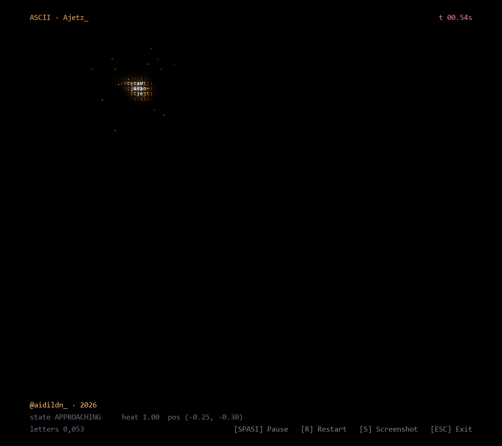
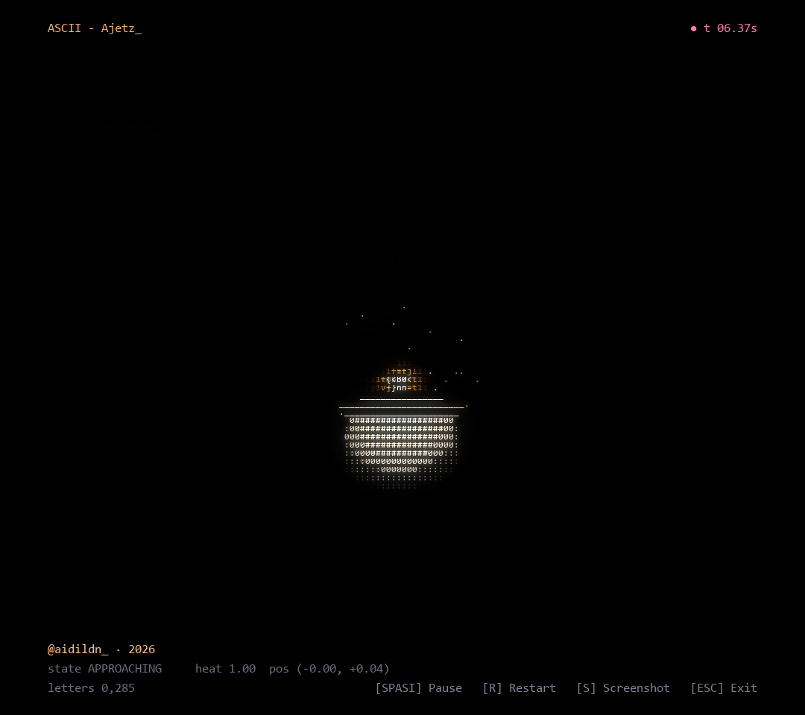
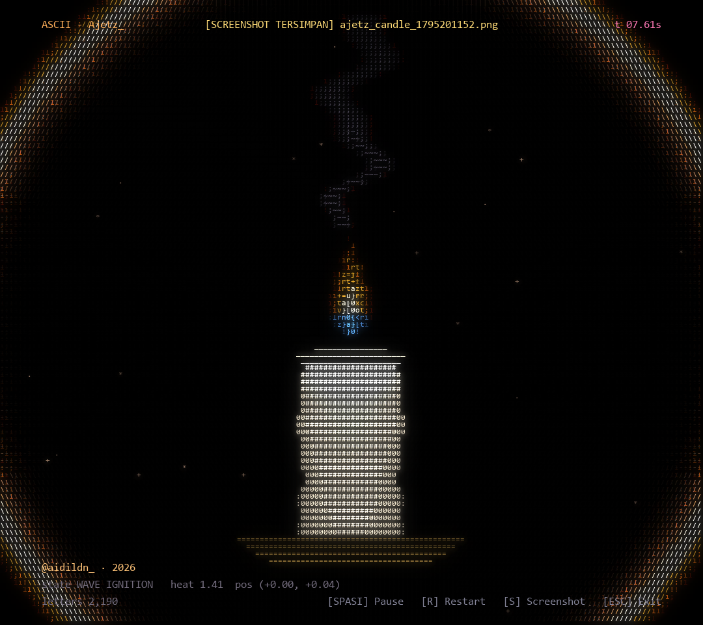
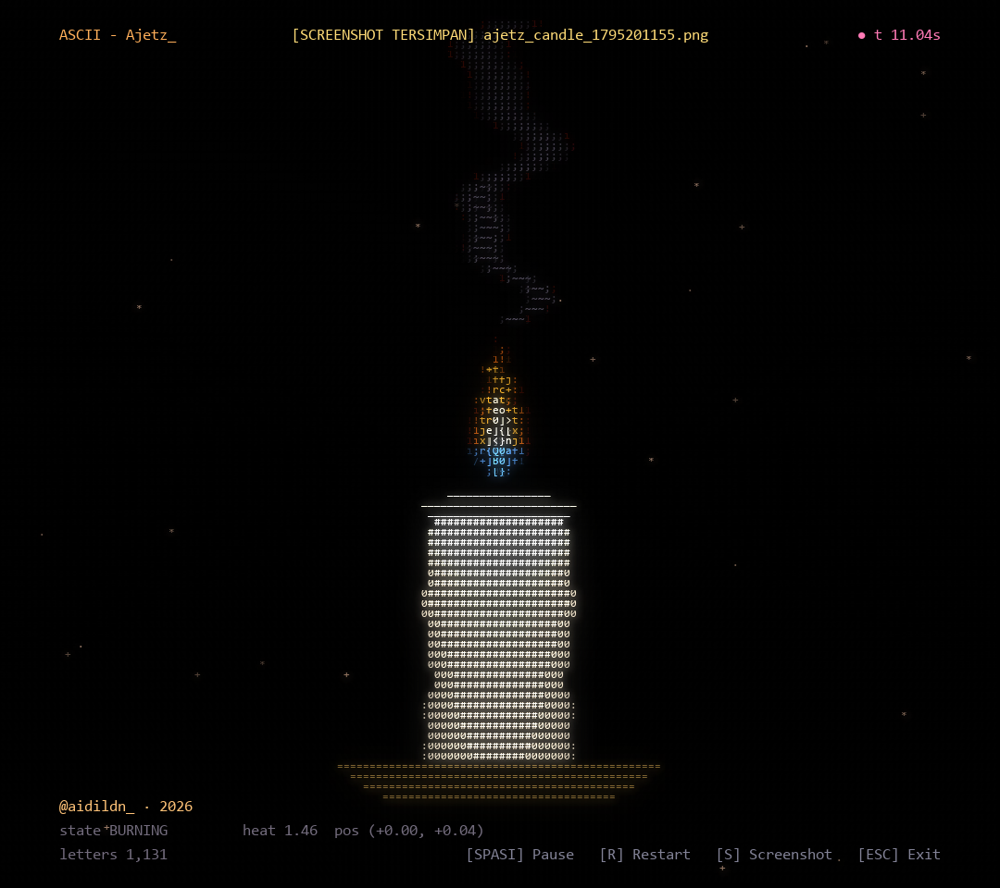

<<<<<<< HEAD
# Candle Flame - Procedural ASCII Art Simulation

A real-time procedural ASCII art visualizer featuring a flying flame wisp traveling through pitch darkness, igniting a candle wick, and releasing an expanding circular light wave that illuminates the scene.

> [!NOTE]
> **AI Assistance Disclaimer**
> This project was designed and built with the assistance of AI tools.

---

## Alur Visual Sinematik & Dokumentasi Proyek

Animasi ini memiliki 4 fase progresif yang dirender secara murni menggunakan karakter tipografi ASCII monospaced:

### Fase 1: Kegelapan Total & Lentera Melayang ($t = 0.0\text{s} - 6.4\text{s}$)
Sebelum sumbu lilin menyala, seluruh ruangan gelap gulita (*pitch black*). Hanya roh api melayang dengan jangkauan lingkaran cahayanya yang tampak di layar.



### Fase 2: Kontak Sumbu & Kilatan Ignisi ($t = 6.4\text{s}$)
Roh api terbang menyentuh ujung sumbu lilin (*ignisi*), menghasilkan kilatan cahaya putih-emas terang dengan intensitas suhu tinggi.



### Fase 3: Gelombang Lingkaran Pembuka Cahaya ($t = 6.4\text{s} - 8.0\text{s}$)
Gelombang energi berbentuk lingkaran (*circular shockwave*) merambat membesar dari sumbu lilin ke seluruh penjuru layar. Batas gelombang digambar dengan karakter kontur tangen dinamis (`/`, `-`, `\`, `|`). Setiap koordinat yang tersapu gelombang lingkaran seketika menyala, memperlihatkan badan lilin, tatakan, dan partikel latar.



### Fase 4: Lilin Menyala Stabil & Konveksi Asap ($t \ge 8.0\text{s}$)
Gelombang telah membuka seluruh pemandangan. Api lilin menari stabil dengan dasar biru hidrokarbon, inti emas panas, lelehan lilin 3D, serta asap tipis yang membumbung ke atas.



---

## Arsitektur Sistem & Cara Kerja

Proyek ini menggunakan arsitektur **Procedural ASCII Software Shader**:

1. **Jaring Koordinat 2D Ter-vektorisasi**:
   - Ruang komputasi dinormalisasi pada rentang $X \in [-1.2, 1.2]$ dan $Y \in [-1.0, 1.0]$.
   - Setiap sel karakter mengevaluasi fungsi medan skalar suhu (*heat*), lelehan lilin (*wax density*), dan konveksi asap (*smoke turbulence*).

2. **Dynamic Darkness Masking & Shockwave Unlocking**:
   - Sebelum $t = 6.4\text{s}$, visibilitas di luar radius lentera api melayang dipotong (*clamped to zero*).
   - Setelah ignisi, fungsi radius gelombang $R(t)$ secara permanen menghapus batas kegelapan dari seluruh area yang dilewatinya.

3. **Font Atlas & Monospace Quantization**:
   - Pygame me-rasterisasi glif ASCII ke dalam atlas tekstur bitmap.
   - Nilai intensitas panas dipetakan ke tingkat kepadatan karakter (`.`, `:`, `+`, `*`, `#`, `@`, dll.) dan pewarnaan termal 9 palet.

4. **Multi-Pass Post-Processing Bloom**:
   - Efek pendaran terminal (*glow*) dihasilkan dengan blit bertingkat menggunakan filter Gaussian blur dan percampuran `BLEND_ADD`.

---

## Teknologi yang Digunakan

- **Python 3.9+**: Bahasa pemrograman utama.
- **NumPy**: Komputasi numerik medan skalar berbasis array 2D secara instan.
- **Pygame-CE (Community Edition)**: Manajemen window, pemetaan atlas font monospaced, dan penanganan input keyboard.

---

## Cara Menjalankan

### 1. Instalasi Dependensi
Pastikan Python 3 sudah terinstal di komputer Anda, lalu jalankan:

```bash
cd candle_flame
pip install -r requirements.txt
```

### 2. Menjalankan Simulasi
```bash
python candle.py
```

---

## Tombol Kontrol Interaktif

Aplikasi dilengkapi tombol kontrol untuk memudahkan eksplorasi dan pengambilan dokumentasi:

| Tombol | Fungsi | Keterangan |
| :---: | :--- | :--- |
| **`[SPASI]`** | **Pause / Resume** | Menjeda atau melanjutkan animasi. Layar menampilkan teks `[PAUSED]` saat dijeda. |
| **`[R]`** | **Restart** | Mengulang animasi dari detik awal ($t = 0.00\text{s}$). |
| **`[S]`** | **Screenshot** | Mengambil gambar tangkapan layar beresolusi penuh dan menyimpannya ke folder `images/`. |
| **`[ESC]`** | **Exit** | Menutup dan keluar dari simulasi secara bersih. |

---

## Aturan & Ketentuan Penggunaan (Usage Guidelines)

Kode ini dibagikan untuk sarana belajar, eksplorasi kreatif, dan eksperimen seni komputasi:
- Harap tidak mengklaim atau mengunggah ulang kode ini sebagian besar maupun seluruhnya sebagai karya pribadi Anda.
- Harap tidak mengunggah ulang karya visual (baik video maupun tangkapan layar) sebagai ciptaan sendiri.
- Tidak diperkenankan menjual atau menggunakannya untuk tujuan komersial tanpa izin tertulis dari pembuat.
- Tidak diperkenankan memanfaatkan karya ini untuk pelatihan model kecerdasan buatan (AI) tanpa persetujuan.

---

## Connect & Contact

Dibuat oleh **Aidil** (`Ajetz_`).

Jika Anda memiliki pertanyaan seputar proyek ini, tertarik berkolaborasi dalam karya kreatif komputasional, atau ingin melihat perkembangan proyek ASCII art lainnya, silakan terhubung melalui:

📸 **Instagram**: [@aidildn_](https://www.instagram.com/aidildn_/)
=======
# ASCII-Art
>>>>>>> 7386ef009c9dd9ebfe1dce56ad87e6636b8a6ad5
